<!--
  演示写法速查（详见 slipmode.html 顶部注释）
  自动：标题页、每个 # 章节页、每个 ## 前停顿并滑到顶部
  :::{.incremental}  列表逐条出现（与 revealjs 相同）
  . . .  停顿     . . . up / center / stay     ## 标题 {.stay} {.center} {.nobreak}
  ::: replace  原地替换    ::: key  重点框    ::: web-only / slide-only
  [文字]{.hl} 荧光笔    [文字]{.ul} 手绘下划线
  演示快捷键：O 目录  W 批注笔  L 激光笔  D 聚焦  B 黑屏  ? 帮助
-->

# Introduction and Goals

## Three Goals of This Chapter

:::{.incremental}
1. Review major macroeconomic time series with focus on **long-run behavior**

2. Gradually introduce the **basic framework**—the neoclassical growth model—that will be the core tool throughout the textbook
   - Each graph interpreted from this framework's perspective
   - Hard to account for data without it

3. Serve as **stepping stone** into the rest of the text
:::

## Key Features of the Framework

:::{.incremental}
- Goes back to Solow’s growth model, then adds conscious choices (saving, labor supply, technology development)
- Microeconomic approach: explicit optimization, cross-sectional data
- No presumption of perfect markets: emphasis on identifying specific frictions
- **Quantitative**: account for magnitudes, not just qualitative features
:::

# Output Grows Steadily

## Fact 1: Output Per Capita Grows Steadily

GDP per capita in the US (log scale), 1840–2018

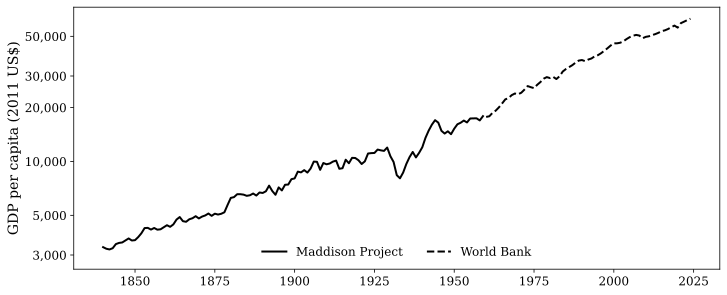{.lightbox fig-align="center" width="45%"}

:::{.incremental}
- Almost constant growth over 100+ years ([≈ 1.86%/year]{.hl})
- Major swings (including the Great Recession) barely visible from bird's-eye view
:::

. . .

::: key
**Goal**: account for output growth by examining the production side—how basic inputs and their prices have evolved.
:::

# Resources Behind Output—and their Prices

## Fact 2: Capital-Output Ratio Is Roughly Constant

Capital-output ratio in the US, 1929–2022

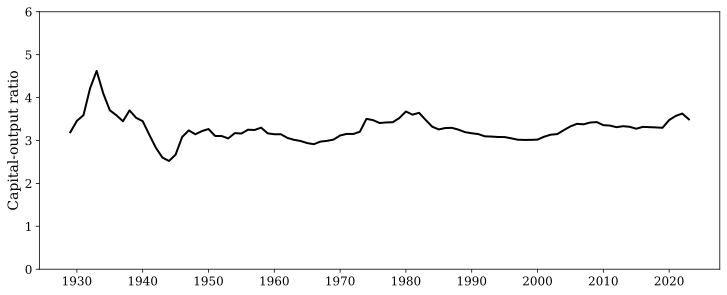{.lightbox fig-align="center" width="70%"}

:::{.incremental}
- [Clear stability at a value of around 3]{.hl}
- Jaggedness during the Great Depression, but stable thereafter
- This had puzzled economists: seemed to suggest a rigid technology with no role for labor
- **Solow (1956)** showed this constancy is natural in the neoclassical framework
:::

## Wealth-Output Ratio

Wealth-output ratio in the US

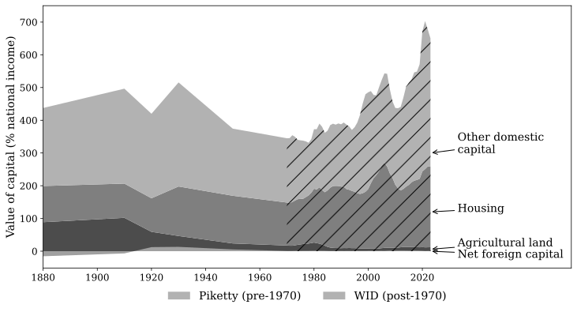{.lightbox fig-align="center" width="70%"}

:::{.incremental}
- Broader interpretation: wealth (includes land, housing)
- Also shows marked stability, though the level is [4–5 rather than 3]{.hl}
- Large changes in **composition**
:::

## Fact 3: Return on Capital Is Roughly Constant

Return on capital: annualized stock market returns, three periods

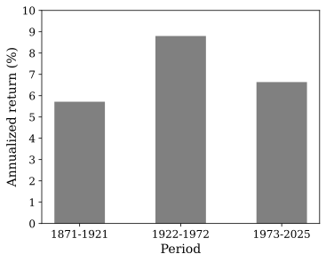{.lightbox fig-align="center" width="40%"}

:::{.incremental}
- Under competitive markets: stock-market returns ≈ marginal cost of investment = price of capital
- [No strong trend]{.hl} across three long periods
- Short-run fluctuations are large (due to asset valuations), so longer-run averages are more appropriate
:::

. . .

User cost of capital (Hall and Jorgenson, 1969): interest rate + depreciation + fall in value. Also stationary.

## Fact 4: Hours Worked Per Capita Are Roughly Constant (Postwar)

Average weekly hours worked in the US (age 14+)

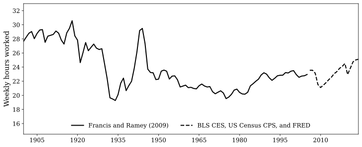{.lightbox fig-align="center" width="50%"}

:::{.incremental}
- Since the beginning of the 20th century: hours fell from ∼28 to ∼23 hours/week
- Since the end of WWII: hours look stable
- [“US hours are stationary”]{.hl} is accurate for the postwar period
- Large departures during the Great Depression and WWII
:::

## Fact 5: Wages Have Risen at or above Output Growth Rate

Average weekly hours worked in US manufacturing, and real wages, 1830–2023

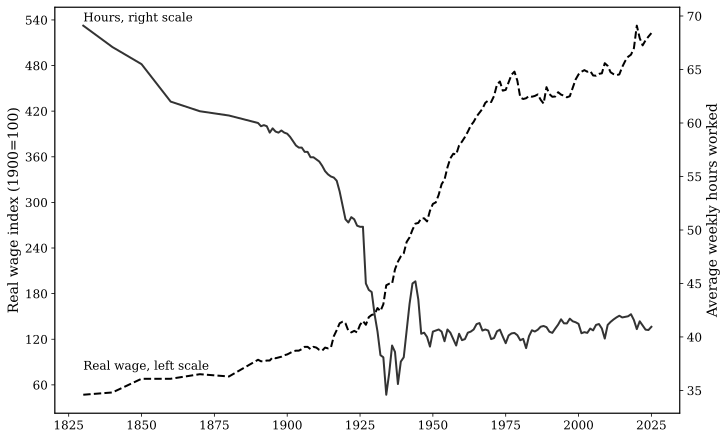{.lightbox fig-align="center" width="70%"}

:::{.incremental}
- Clear downward trend in hours over the long time period
- Wages have [risen dramatically]{.hl}
:::

# A Neoclassical Picture Emerges

## Solow's Interpretation

The data on capital and output had puzzled economists. Solow (1956) noted:

:::{.incremental}
- Steady rise in output; equally steady rise in capital; stationary (or declining) hours
- Price of capital stationary; wages trending upward
- **Natural interpretation**: labor has become more expensive relative to capital ⇒ firms use less labor relative to capital
- Capital-labor ratio has risen at the rate of output growth
:::

. . . center

::: key
**Why hasn't the return to capital fallen?**
:::

. . .

Technological change directed toward labor (making labor more productive) would increase the value of capital on the margin. But a **neoclassical** production function (decreasing marginal returns) ensures that as $K/L$ rises, the marginal value of capital falls back.

. . .

These two forces [offset]{.ul}, keeping the return to capital stationary.

## The Aggregate Production Function

Solow posited that aggregate output is generated by

$$y_t = F_t(k_t, \ell_t)$$

:::{.incremental}
- $k_t$: aggregate capital per capita; $\ell_t$: hours worked per capita
- $F_t$: production function that may shift over time (technological progress)
- **CRS**: doubling inputs doubles output
- **Neoclassical**: decreasing marginal returns to each input
:::

. . .

::: web-only
::: {.callout-note title="The Cambridge Capital Controversy (1950s)"}
Joan Robinson and Piero Sraffa (Cambridge, UK) vs. Samuelson and Solow (MIT). The question was whether an aggregate production function can exist rigorously when output aggregates many goods. The existence conditions are knife-edge. But the **usefulness** of the aggregate production function is well established empirically—Cambridge, Mass. “won” on pragmatic grounds.
:::
:::

::: slide-only
::: {.callout-note title="Aside: the Cambridge capital controversy (1950s)"}
Robinson & Sraffa (Cambridge, UK) vs. Samuelson & Solow (MIT): can an aggregate production function exist? Rigorously only in knife-edge cases, but it [works empirically]{.hl}.
:::
:::

# Growth Accounting

## Solow’s Growth Accounting: Derivation

Assumptions: (i) $y_t=F(k_t, \ell_t, t)$, CRS, neoclassical; (ii) perfect competition for inputs.

. . .

Differentiating:

$$dy = \frac{\partial F}{\partial t}dt + \frac{\partial F}{\partial k}dk + \frac{\partial F}{\partial \ell}d\ell$$

. . .

Divide by $y$, use profit maximization ($r = \partial F/\partial k$, $w = \partial F/\partial \ell$), and let $\alpha$ be capital’s share and $1-\alpha$ labor’s share (CRS ⇒ zero pure profits):

. . .

::: key
$$\frac{dy}{y} = \underbrace{\frac{\partial F}{\partial t}\frac{dt}{F}}_{\text{Solow residual}} + \alpha \frac{dk}{k} + (1-\alpha)\frac{d\ell}{\ell}$$

**Output growth** = weighted sum of input growth rates + residual.
:::

## TFP and Labor-Augmenting Technology

::: {layout-ncol=2}
::: {}
**Hicks-neutral (TFP)**

$F(k,\ell,t) = z F(k,\ell)$

$$\frac{dy}{y} = \frac{dz}{z} + \alpha \frac{dk}{k} + (1-\alpha)\frac{d\ell}{\ell}$$

$z$ is total factor productivity: a common factor multiplying both inputs.
:::

::: {}
**Labor-augmenting (Harrod-neutral)**

$F(k, \ell, t) = F(k, z\ell)$

$$\frac{dy}{y} = (1-\alpha)\frac{dz}{z} + \alpha \frac{dk}{k} + (1-\alpha)\frac{d\ell}{\ell}$$

Technology enters as if it multiplied hours worked.
:::
:::

. . .

::: key
**Key result (Uzawa, 1961)**: for balanced growth in a model with a limited input (labor hours constant), technological change [must be labor-augmenting]{.hl}. This is not a choice but a **necessity**.
:::

## Labor Productivity

Labor productivity in the US, sub-periods

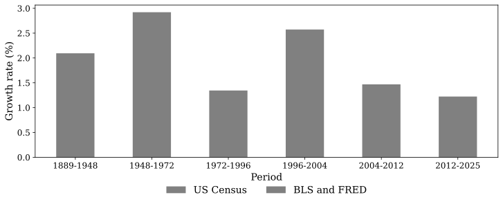{.lightbox fig-align="center" width="50%"}

:::{.incremental}
- Average growth rate: [a little below 2% per year]{.hl}
- Significant ups and downs across sub-periods
- Currently in a "down" period
:::

## Labor Productivity: Cross-Country

Labor productivity for a selection of countries (HP-filtered)

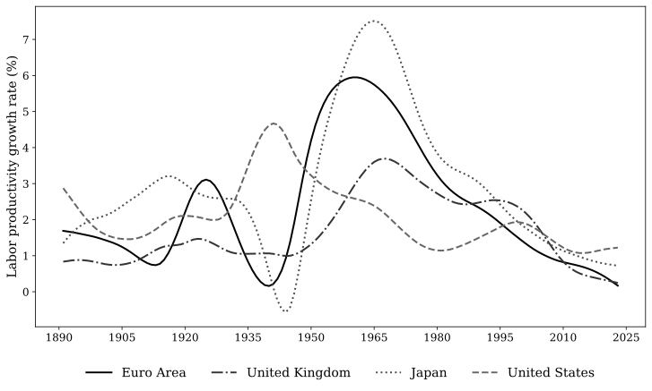{.lightbox fig-align="center" width="50%"}

:::{.incremental}
- Stable, positive labor productivity growth across countries
- Hovering around [2–2.5% per year]{.hl}
- Similar patterns across advanced economies
:::

## Total Factor Productivity: US

TFP in the US (two measures)

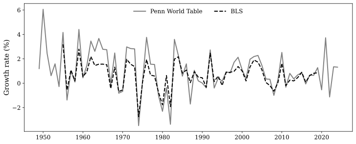{.lightbox fig-align="center" width="50%"}

:::{.incremental}
- TFP growth at [a little below 2% per year]{.hl}
- Significant movements up and down
:::

## Total Factor Productivity: Cross-Country

Historical TFP for a broader set of countries (HP-filtered)

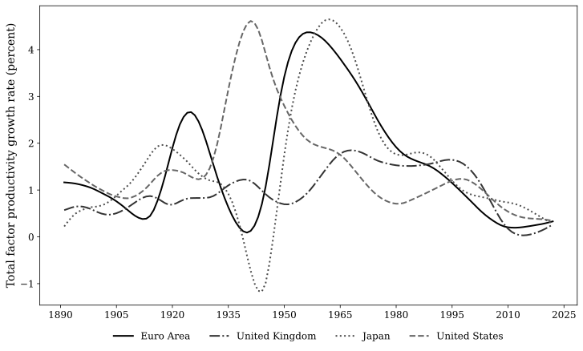{.lightbox fig-align="center" width="50%"}

:::{.incremental}
- Similar patterns across countries
- Smoothed data shows long-run trends more clearly
:::

# The Dynamic System

## Capital Accumulation

Tomorrow's capital = today's capital + investment − depreciation:

$$k_{t+1} = (1 - \delta)k_t + i_t$$

. . .

Dividing by $y_{t+1}$, and letting $\gamma_t$ denote the net growth rate of output:

$$\frac{k_{t+1}}{y_{t+1}}(1+\gamma_t) = (1 - \delta)\frac{k_t}{y_t} + \frac{i_t}{y_t}$$

. . .

::: key
**Balanced growth path**: if $k$, $i$, $y$ all grow at constant rate $\gamma$ with constant saving rate $i_t/y_t = s$,

$$\frac{k}{y} = \frac{s}{\gamma + \delta}$$
:::

. . .

Numerical check: $\delta \approx 0.08$, $\gamma \approx 0.02$, $s \approx 0.30$ ⇒ [$k/y = 3$ ✓]{.hl}

## The Consumption-Output Ratio

Ratio of total consumption to output

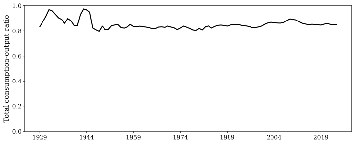{.lightbox fig-align="center" width="50%"}

:::{.incremental}
- Large movements early in the 20th century
- Thereafter: small movements
- $1 - c/y \approx$ investment-output ratio (net exports ≈ 0 for the US)
- Overall: the assumption of a [constant saving rate]{.hl} is a good first approximation
:::

## The Solow Model: Convergence

Solow's dynamic system (labor-augmenting technology, constant $\ell$, constant saving rate $s$):

$$k_{t+1} = sF\big(k_t, (1+\gamma)^t \ell\big) + (1-\delta)k_t$$

. . .

Variable transformation: $\tilde{k}_t \equiv k_t/(1+\gamma)^t$ (stationary if $k$ grows at rate $\gamma$):

$$(1+\gamma)\tilde{k}_{t+1}=sF(\tilde{k}_t, \ell)+(1-\delta)\tilde{k}_t$$

. . .

**Unique steady state**: $\bar{\tilde{k}}$ solves $(1+\gamma)\tilde{k}=sF(\tilde{k}, \ell)+(1-\delta)\tilde{k}$

. . .

::: key
**Convergence**: under neoclassical conditions, for any initial $k_0$, the economy converges to the balanced growth path.
:::

:::{.incremental}
- When $k$ is low: high marginal productivity ⇒ fast accumulation
- When $k$ is high: low marginal productivity ⇒ slow accumulation
- This de-mystifies why $k/y \approx 3$: [deviations are self-correcting]{.hl}
:::

## From Solow to the Workhorse Model

The convergence property makes this framework the **workhorse model** for macroeconomics:

:::{.incremental}
- Business cycles: add stochastic shocks to the dynamic system
- Supply shocks or demand shocks: propagation differs, but all paths eventually return toward balanced growth
- Convergence is ensured by the neoclassical production function
:::

. . .

**Unresolved issue**: some assumptions are mere mechanical descriptions:

:::{.incremental}
- Investment is a constant fraction $s$ of output
- Hours worked are constant at $\ell$
:::

. . .

::: key
These should be the results of **conscious choices** by households. We need to [“rationalize” $s$ and $\ell$]{.hl} based on utility maximization.
:::

# Factor Shares

## Fact 6: Factor Shares Are Roughly Constant

US factor shares over time

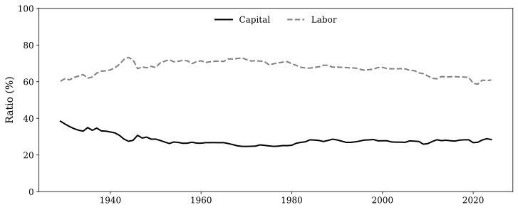{.lightbox fig-align="center" width="50%"}

:::{.incremental}
- On balanced growth: $rk$ grows at the rate of output ($r$ constant, $k$ grows at $\gamma$); $w\ell$ grows at the rate of output ($w$ grows at $\gamma$, $\ell$ constant)
- Therefore shares should be constant ⇒ confirmed by the data
- [Remarkable constancy]{.hl} over the full sample
:::

## The Recent Decline in the Labor Share

::: replace
::: {}
Labor share for the US, Japan, France, Germany

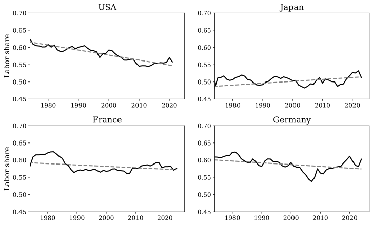{.lightbox fig-align="center" width="50%"}
:::

::: {}
Global labor share

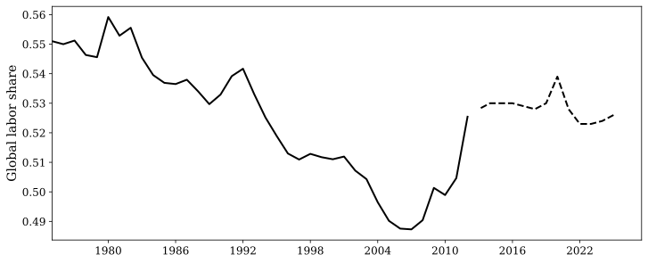{.lightbox fig-align="center" width="50%"}
:::
:::

:::{.incremental}
- Restricting the time interval: [noticeable downward trend]{.hl .red} in recent decades
- Observed in the US, Japan, France, Germany, and globally
- Subject to much scrutiny and research
- For now: maintain the stylized fact as “close to constant over time”
:::

## The Cobb-Douglas Production Function

Virtually all applied macro studies use

::: key
$$F(k, \ell) = Ak^\alpha \ell^{1-\alpha}$$
:::

:::{.incremental}
- $\alpha$: constant capital share; $1-\alpha$: constant labor share
- Under perfect competition: $F_k k/F = \alpha$ (independent of $k$ and $\ell$)
- Factor shares constant regardless of business-cycle position
- Although shares are not literally constant, movements are relatively minor
- Cobb-Douglas generates a decent approximation, hence its wide use
:::

# Summing up the Stylized Facts

## The Seven Stylized Facts

:::{.incremental}
1. Output per capita has grown at a **roughly constant rate**
2. The capital-output ratio has remained **roughly constant**
3. The consumption-output ratio has been **roughly constant**
4. The wage rate has grown at a roughly constant rate **equal to the growth rate of output**
5. The real interest rate has been **roughly constant** (over longer periods)
6. Labor share of output has remained **roughly constant**
7. Hours worked per capita have been **roughly constant** (postwar)
:::

. . .

::: key
These facts are consistent with a **neoclassical framework**: CRS production function with labor-augmenting technical change, decreasing marginal products, constant labor supply, constant depreciation rate, constant saving ratio.
:::

# Rationalizing Saving and Labor Supply

## Time and People

**Time**: discrete (mostly) or continuous; infinite horizon (a finite $T$ creates non-stationarity, and $T$ is virtually irrelevant for decisions far from $T$).

. . .

**People**: utility-maximizing agents.

:::{.incremental}
- “Rationalize” observed choices as optimal given well-defined problems
- Allows welfare statements and normative policy comparisons
- Baseline: **representative agent, dynastic** (lives forever = cares about offspring)
- Also common: life-cycle models, overlapping generations, heterogeneous agents
:::

## The Euler Equation

**Preferences**: time-additive, $u(c_t) + \beta u(c_{t+1})$

:::{.incremental}
- Same $u$ in both periods ⇒ consumption in both periods are normal goods
- Concavity ⇒ consumption smoothing
- $\beta < 1$: impatience (or probability of death)
:::

. . .

Setting MRS = relative price (gross real interest rate $R_{t+1}$):

$$\frac{u'(c_t)}{\beta u'(c_{t+1})}=R_{t+1}$$

Equivalently:

::: key
$$u'(c_t) = \beta R_{t+1}\, u'(c_{t+1})$$
:::

. . .

**Interpretation**: the marginal utility lost by saving one unit today equals the discounted marginal utility gained from consuming $R_{t+1}$ units tomorrow.

## Balanced Growth Requires Power Utility

**Key question**: can balanced growth (constant consumption growth, constant $R$) be consistent with the Euler equation?

. . .

**Result**: balanced growth arises in equilibrium [if and only if]{.ul} the utility function is a power function:

::: key
$$u(c) = \frac{c^{1-\sigma} - 1}{1-\sigma}, \qquad \sigma > 0$$

The case $\sigma \to 1$ yields $u(c) = \log c$.
:::

. . .

**Why?** With power utility, $u'(c_t)/u'\big((1+\gamma)c_t\big)$ is constant, so a constant $R$ is consistent with constant consumption growth.

. . .

**“Only if”**: for any other $u$, saving rates would go to 0 or 1 over time as the economy grows. Balanced growth as observed in the data would not be possible.

. . .

⇒ [Power utility (CRRA)]{.hl} is used in almost all applications.

## Labor vs. Leisure

Add leisure to utility: $u(c, 1-\ell)$, with leisure $1-\ell$.

. . .

MRS = wage:

$$\frac{u_\ell(c_t, 1-\ell_t)}{u_c(c_t, 1-\ell_t)} = w_t$$

. . .

**Requirement**: constant hours along a balanced growth path where $c$ and $w$ grow at rate $\gamma$.

. . .

**Result**: balanced growth with constant hours [if and only if]{.ul}

::: key
$$u(c, 1-\ell) = \frac{\big(c \cdot v(1-\ell)\big)^{1-\sigma} - 1}{1-\sigma}$$

where $v(\cdot)$ is strictly increasing and $c \cdot v(1-\ell)$ is strictly quasiconcave.
:::

. . .

**Intuition**: at higher wages, the [substitution effect]{.hl .blue} (work more) cancels the [income effect]{.hl} (enjoy more leisure).

## Allowing for Declining Hours

The longer-run data (and cross-country evidence) suggest hours fall slowly (∼1/3 % per year).

. . .

**Result**: balanced growth with hours declining at a constant rate [if and only if]{.ul}

::: key
$$u(c, 1-\ell) = \frac{\big(c^{1-\nu} g(c^{\nu}\ell)\big)^{1-\sigma} - 1}{1-\sigma}$$

with $\nu > 0$ and $g(\cdot)$ decreasing.
:::

:::{.incremental}
- Hours grow at $(1 + \gamma)^{-\nu}$; consumption at $(1 + \gamma)^{1-\nu}$
- $\nu = 0$: collapses to the constant-hours case
- $\nu > 0$: [income effect slightly dominates]{.hl} the substitution effect
- Interpretation: at lower income, people work more because consumption is more important
:::

# Summary

## Key Takeaways

:::{.incremental}
1. **The Kaldor facts** (constant growth rate, constant $k/y$, constant $c/y$, rising wages, stable $r$, stable factor shares, stable hours) motivate the **neoclassical growth framework**

2. **Growth accounting**: the Solow residual is the dominant source of growth

3. **Convergence**: the neoclassical production function ensures the economy returns to its balanced growth path

4. **CRRA utility** is the unique preference specification consistent with balanced growth (constant saving rate, constant or slowly declining hours)

5. The **Euler equation** is the central optimality condition connecting consumption, saving, and interest rates

6. The recent **decline in the labor share** is an active area of research and a departure from the classic Kaldor facts
:::
